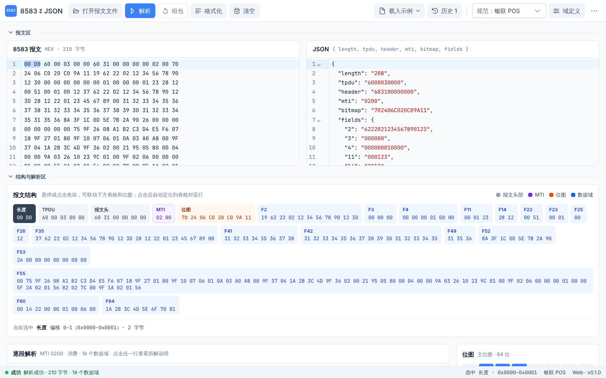

# 8583 ⇄ JSON

ISO 8583 报文与 JSON 双向转换工具：把十六进制报文解析成可读的 JSON，或把 JSON 组包成报文，并逐段展示报文结构、位图和每个域的含义。

提供 **Windows 桌面客户端**和 **Web 版**，两者功能一致。所有解析都在本机完成，报文不会上传到任何服务器。



## 功能

- **解析与组包**：8583 HEX → JSON，JSON → 8583 HEX，结果可往返，不丢信息
- **报文结构可视化**：长度头、TPDU、报文头、MTI、位图、各数据域按字节顺序分色显示；点击任意色块、表格行、位图格或 HEX 字节，其余视图同步选中
- **逐段解析**：每段的格式、长度、原始字节、解析值和业务含义（如处理码、服务点输入方式、应答码）；55 域按 TLV 拆解，60 域等按子域拆解
- **规范可配置**：内置银联 POS 规范，可新建、编辑、导入、导出自己的规范（报文头、编码方式、每个域的类型和长度）
- **示例报文**：消费、撤销、退货、预授权、冲正、签到、批结算等 11 种常见交易，一键载入
- **文件与历史**：打开或拖入 `.hex` / `.txt` / `.bin` / `.json` 文件；最近 50 条解析、组包记录可随时找回
- **布局**：HEX、JSON 编辑器可左右或上下排列；报文区、结构与解析区可各自折叠，方便全屏查看

## 下载与安装

### Windows 客户端

在 [Releases](https://github.com/duwei0227/8583-json/releases) 页面下载最新版本，二选一：

| 文件 | 说明 |
|---|---|
| `8583-json_<版本>_x64-setup.exe` | 安装包。中文界面，安装到当前用户目录，不需要管理员权限 |
| `8583-json_<版本>_x64_portable.zip` | 绿色版。解压后直接运行 `8583-json.exe` |

- 需要 WebView2 运行时，Windows 10 / 11 一般已自带；如提示缺少，从 [微软官网](https://developer.microsoft.com/microsoft-edge/webview2/) 安装
- 程序没有代码签名，首次运行时 Windows 可能提示「已保护你的电脑」，点「更多信息」→「仍要运行」即可
- 规范和历史记录保存在 `%APPDATA%\io.github.duwei0227.iso8583json`，卸载或删除程序文件夹不会清除

### Web 版

纯静态页面，用浏览器打开即可使用；规范和历史记录保存在浏览器本地。部署方式见下文 [Web 版部署](#web-版部署cloudflare-workers)。

## 使用

1. **解析**：把十六进制报文粘贴到「8583 报文」编辑器（空格、换行会被忽略），点「解析」。JSON 和下方的结构、逐段解析、位图随之更新
2. **组包**：在「JSON」编辑器里修改，点「组包」，生成的报文写回 HEX 编辑器并重新解析校验
3. **查看某一段**：点击报文结构的色块、逐段解析的表格行、位图里的域号或 HEX 里的任一字节，都会选中同一段，右侧显示拆解说明
4. **换规范**：工具栏「规范」下拉切换；「域定义」里编辑当前规范

不知道从哪开始时，点工具栏的「载入示例」。

### JSON 格式

键的顺序与报文字节顺序一致：

```json
{
  "length": "208",
  "tpdu": "6000030000",
  "header": "603100000000",
  "mti": "0200",
  "bitmap": "702406C020C09A11",
  "fields": {
    "2": "6222021234567890123",
    "3": "000000",
    "55": "9F2608A1B2C3D4E5F60718…"
  }
}
```

| 键 | 说明 |
|---|---|
| `length` | 长度头的值。**只读**：组包时根据实际长度重新生成，填写的值会被忽略 |
| `tpdu` | TPDU 原始字节（十六进制）；当前规范没有 TPDU 时省略 |
| `header` | 报文头原始字节（十六进制）；当前规范没有报文头时省略 |
| `mti` | 4 位报文类型 |
| `bitmap` | 位图（十六进制）。**只读**：组包时根据 `fields` 里有哪些域重新生成 |
| `fields` | 报文中出现的全部数据域，键为域号（2–128），值为去掉补位后的字符串；`b` 型域为大写十六进制 |

手写 JSON 组包时只需要 `mti`、`fields`，以及规范要求的 `tpdu`、`header`。

### 规范

一套规范描述报文的整体结构和每个域的定义，可在「域定义」里编辑：

- **报文结构**：长度头（2 字节二进制 / 4 位 ASCII / 无）、TPDU 长度、报文头长度及其子段、MTI 编码（BCD / ASCII）、位图编码（二进制 / ASCII HEX）、变长域长度前缀编码
- **数据域**：名称、类型（`n` / `z` / `an` / `ans` / `b`）、长度形式（定长 / LLVAR / LLLVAR）、长度、补位方式、子域拆分（TLV 或按位置切分）

编辑时会实时校验，有问题的草稿不能保存。规范可以导出为 JSON 文件分享给同事，对方「导入规范」即可使用。

### 快捷键

macOS 上 `Ctrl` 换成 `⌘`。完整列表见菜单「帮助 → 快捷键列表」（`Ctrl+/`）。

| 快捷键 | 操作 |
|---|---|
| `Ctrl+Enter` | 解析 8583 → JSON |
| `Ctrl+Shift+Enter` | 组包 JSON → 8583 |
| `Ctrl+Shift+F` | 格式化 HEX 和 JSON |
| `Ctrl+O` | 打开报文文件 |
| `Ctrl+S` / `Ctrl+Shift+S` | 保存 HEX / 保存 JSON |
| `Ctrl+H` | 历史记录 |
| `Ctrl+,` | 编辑当前规范 |

## 开发

架构设计见 [docs/architecture.md](docs/architecture.md)。

### 目录

```
crates/iso8583-core   编解码核心（纯 Rust，无 IO），含内置银联 POS 规范
crates/iso8583-wasm   WASM 封装，供前端调用
src-tauri/            桌面壳（窗口、文件、存储、剪贴板）
src/                  前端（Web 与桌面共用）
  codec/              WASM 加载与类型（types/ 由 Rust 自动生成，勿手改）
  platform/           Web / 桌面差异的唯一出口
  commands/           命令注册表：工具栏、原生菜单、快捷键共用
  stores/             Pinia 状态
  features/           界面：shell · convert · spec · history
  samples/            示例报文，同时是黄金测试样例
e2e/                  端到端测试（Playwright）
```

### 环境要求

- Node.js 22+ 与 pnpm 10+
- Rust（stable）及 `wasm32-unknown-unknown` 目标：`rustup target add wasm32-unknown-unknown`
- [wasm-pack](https://rustwasm.github.io/wasm-pack/)：`cargo install wasm-pack`
- 桌面端额外需要各平台的 Tauri 依赖，见 [Tauri 前置条件](https://tauri.app/start/prerequisites/)（Linux 需安装 `libwebkit2gtk-4.1-dev` 等）

### 常用命令

| 命令 | 作用 |
|---|---|
| `pnpm install` | 安装前端依赖 |
| `pnpm dev` | 构建 WASM 并启动 Web 开发服务器（http://localhost:1420） |
| `pnpm tauri dev` | 桌面端开发模式（需先执行一次 `pnpm wasm`） |
| `pnpm build:web` | 构建 Web 版，产物在 `dist/` |
| `pnpm build:desktop` | 打包桌面安装包 |
| `pnpm test` | 前端单元测试（Vitest，需先执行一次 `pnpm wasm`） |
| `pnpm test:e2e` | 端到端测试（Playwright，自动启动开发服务器；需先执行一次 `pnpm wasm`，首次还需 `pnpm exec playwright install chromium`） |
| `pnpm typecheck` | 前端类型检查 |
| `cargo test` | Rust 测试；同时把 Rust 类型导出到 `src/codec/types/` |
| `cargo clippy --workspace --all-targets -- -D warnings` | Rust lint（含桌面壳） |

### 依赖版本说明

- **PrimeVue 固定为 4.5.5、PrimeIcons 固定为 7.x**：两者从 5.x / 8.x 起改为需要 License Key 的 PrimeUI 授权，4.5.5 / 7.x 仍为 MIT。升级前请先确认授权
- **TypeScript 使用 6.x**：TypeScript 7（原生版）暂不提供 vue-tsc 依赖的 JS API
- **WASM 暂不经过 wasm-opt**：旧版 binaryen（如 Ubuntu 自带的 108）会破坏新版 Rust 的产物，浏览器加载时报 `Table.grow` 失败。详见 `crates/iso8583-wasm/Cargo.toml`

## 发布

### Windows 客户端

先把 `package.json` 里的 `version` 改成要发布的版本并提交，然后任选一种方式（工作流见 `.github/workflows/release.yml`）：

- **网页手动发布**：GitHub 的 Actions 页面选择「Release (Windows)」→「Run workflow」，「发布版本」填 `v0.1.0`。工作流在所选分支的最新提交上创建该标签，构建后发布 GitHub Release
- **推送标签**：`git tag v0.1.0 && git push origin v0.1.0`

两种方式都会检查版本号与 `package.json` 一致；手动发布时标签已存在会直接失败，不会覆盖。只想试构建时，手动运行并把「发布版本」留空，产物在该次运行的 Artifacts 里，不会发布 Release。

### Web 版部署（Cloudflare Workers）

Cloudflare 直接连接本仓库，推送到 `master` 后自动构建部署。一次性配置：

1. 登录 Cloudflare 控制台 → **Workers & Pages** → **Create** → 导入本 GitHub 仓库
2. 构建设置：**Build command** 填 `bash scripts/cf-build.sh`，**Deploy command** 保持默认的 `npx wrangler deploy`，根目录为仓库根目录，生产分支选 `master`
3. 保存并部署。完成后网址为 `https://iso8583-json.<你的子域>.workers.dev`，可在设置里绑定自己的域名

Cloudflare 的构建镜像不含 Rust，`scripts/cf-build.sh` 会先安装 Rust 与 wasm-pack 再构建，每次部署大约 4 分钟。站点配置在 `wrangler.jsonc`；响应头在 `public/_headers`，其中 CSP 只允许加载本站资源，报文不会被发送到任何其他地址。
